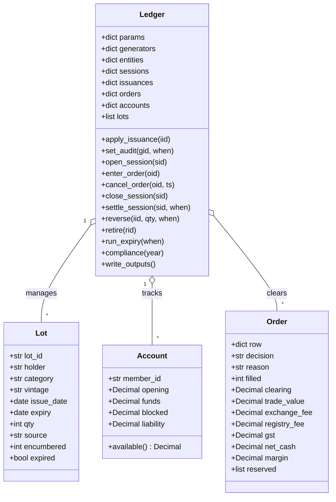
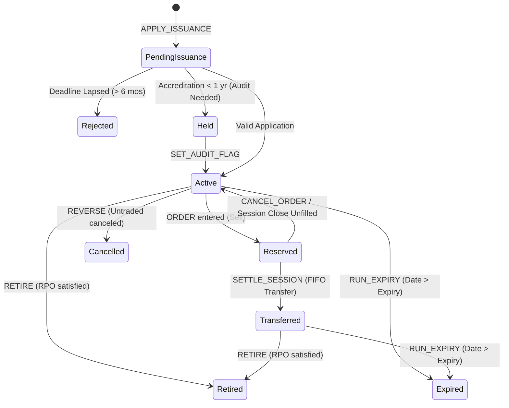

# CARBON EXCHANGE REGISTRY & SETTLEMENT ENGINE
## Software Design Document — Week 3: Full Rules, Validation, and Edge Cases

| Document Field | Details |
|---|---|
| **Project Code** | PS-082 |
| **Domain** | Energy – Carbon Markets |
| **Technology** | Python 3.10+ (Standard Library: `csv`, `decimal`, `datetime`, `dataclasses`, `pathlib`) |
| **Application Type** | Command-file-driven backend trading and settlement engine; no UI |
| **Checkpoint** | Week 3 – Full Rules, Validation, and Edge Cases |
| **Version** | 3.0 |
| **Prepared For** | Capstone Evaluation Team |

---

## 1. Executive Summary & Purpose

This document provides the complete Week 3 technical design and specification for the **Carbon Exchange Registry and Settlement Engine (PS-082)**. 

Building upon the conceptual foundations from Week 1 and baseline execution from Week 2, Week 3 achieves:
1. **Full Implementation of all 17 Business Rules (BR-01 to BR-17)**.
2. **Explicit, Deterministic Handling of all 8 Edge Cases (EC-01 to EC-08)** with clear decision outcomes and unambiguous error messages.
3. **Comprehensive Test Traceability**: 100% test coverage across all rule IDs and edge cases.
4. **Authoritative Output Contract**: Production of 6 standardized CSV reports strictly conforming to evaluation schemas.

---

## 2. Glossary of Terms

| Term | Definition |
|---|---|
| **REC** | Renewable Energy Certificate representing 1 MWh of verified renewable electricity generation. |
| **Carbon Credit** | Unit representing 1 metric tonne of CO2-equivalent verified greenhouse gas reduction. |
| **Generator** | Renewable energy producer registered under Solar, Wind, or Biomass technology. |
| **Obligated Entity** | Power distribution entity required to fulfill prescribed annual Renewable Purchase Obligations (RPO). |
| **RPO Target** | Statutory requirement: 10% Solar RPO and 15% Non-Solar RPO of annual electricity consumption (MWh). |
| **Uniform Clearing Price** | The single market-clearing price calculated where cumulative demand equals cumulative supply. |
| **Floor & Forbearance Band** | Trading price corridor: Floor = Rs 1,000; Forbearance (Cap) = Rs 3,000 per certificate. |
| **Marginal Pro-Rata** | Proportional allocation of matched quantities at the clearing price using whole-unit floor division. |
| **Residual Units** | Whole units left unallocated after floor-division pro-rating at the marginal price. |
| **FIFO Transfer** | First-In, First-Out transfer ordering prioritizing certificates by oldest generation vintage. |
| **Buffer Pool** | Reserve of 5% withheld carbon credits per issuance to absorb verification reversals. |
| **Reversal** | Post-issuance cancellation due to audit or verification failure; generates rupee deficit liability if unbacked. |
| **Carry-Forward** | One-time allowance for entities achieving $\ge 90\%$ compliance to defer remaining shortfall without penalty. |

---

## 3. System Architecture & UML Class Diagram

### 3.1 Architecture Overview
The engine follows a modular, command-driven architecture with clean separation of concerns:
- **CLI Layer (`cli.py`)**: Parses `--data` and `--output` directory arguments.
- **Engine Core (`engine.py`)**: Implements registry state, auction matching, accounting ledger, and compliance reporting.
- **Data Pack (`data/`)**: Source CSVs (`parameters`, `generators`, `entities`, `opening_holdings`, `sessions`, `issuances`, `orders`, `retirements`) and ordered `commands.txt`.
- **Output Layer (`output/`)**: Generates 6 deterministic CSV reports.

---

## 4. Certificate Lifecycle & State Diagram

A certificate moves deterministically through lifecycle states. Partial fills and partial retirements split lots while preserving vintage, issue date, and expiry.

---

## 5. Business-Rule Register (BR-01 through BR-17)

### BR-01: REC Issuance Ratio and Application Deadline
- **Ratio**: $1\text{ REC} = 1\text{ MWh}$ of metered generation, rounded down (`floor`).
- **Deadline**: Application must be submitted within 6 calendar months of the generation month (month-end arithmetic: March generation $\rightarrow$ September 30 deadline).
- **Outcome**: Applications submitted on or before deadline $\rightarrow$ `ISSUED`; after deadline $\rightarrow$ `LAPSED` with reason `APPLICATION_AFTER_<deadline>`.

### BR-02: Generator Accreditation and Audit Flag
- **Rule**: If `application_date < accreditation_date + 12 months`, issuance requires `audit_flag == "true"`.
- **Outcome**: If audit flag is false $\rightarrow$ `HELD` with reason `AUDIT_REQUIRED`. When `SET_AUDIT_FLAG` is processed, pending issuances are issued with reason `AUDIT_APPROVED_<date>`.

### BR-03: Carbon Credit Issuance and Buffer Withholding
- **Rule**: $1\text{ Carbon Credit} = 1\text{ verified tonne } \text{CO}_2\text{e}$.
- **Buffer**: 5% withheld into generator's buffer pool (`floor(verified_tco2e * 0.05)`). Net credits issued = `gross - buffer`.

### BR-04: Buffer Pool Release
- **Rule**: After 3 consecutive carbon issuances without reversal, accumulated buffer credits are released as active lots to the generator.
- **Streak Reset**: Any reversal resets the consecutive count to 0.

### BR-05: Certificate Category Segregation
- **Markets**: Solar RECs and Non-Solar RECs trade in separate sessions. Orders with mismatched categories are `REJECTED` (`CATEGORY_MISMATCH`).
- **Retirement Substitution**: Solar RECs may satisfy non-solar shortfall only after the solar target is 100% satisfied. Non-solar RECs can never satisfy solar obligations.

### BR-06: Vintage and Expiry
- **Lifespan**: Valid for 36 months after the end of the generation/issuance month.
- **Expiry Rule**: Expiry is inclusive: trading on the expiry date is valid. Certificates expire when `current_date > expiry_date`.

### BR-07: Uniform-Price Double Auction Clearing
- **Order Priority**: Buys sorted descending by price, then timestamp; Sells sorted ascending by price, then timestamp.
- **Price Discovery**: Single uniform clearing price maximizing executable volume. When equal volume is achieved across multiple prices, choose the lowest price.

### BR-08: Marginal Pro-Rata Allocation
- **Rule**: Orders at the marginal price share available volume proportionally by quantity:
  $$\text{Allocated} = \left\lfloor \frac{\text{Target} \times \text{Order Qty}}{\text{Total Marginal Qty}} \right\rfloor$$
- **Residual Units**: Floor division remainder is left unfilled and recorded in `session_summary.csv`.

### BR-09: Floor and Forbearance Constraints
- **Band**: Permitted price band: $\text{Rs } 1,000 \le P \le \text{Rs } 3,000$.
- **Rejection**: Orders outside band are `REJECTED` at entry (`PRICE_OUTSIDE_BAND`).
- **Forbearance Cap**: If clearing price exceeds forbearance (or demand exceeds supply at cap), all sells at or below cap clear and buys are pro-rated at forbearance price (`FORBEARANCE_BOUND`).

### BR-10: Trading Fees and GST
- **Exchange Fee**: 0.5% of trade value from buyer and seller.
- **Registry Fee**: Rs 2.00 per certificate from seller only.
- **GST**: 18% applied to all fees. Fees settle T+1.
- **Net Cash Flow**:
  - Buyer: $-(\text{Trade Value} + \text{Exchange Fee} + \text{GST})$
  - Seller: $+(\text{Trade Value} - \text{Exchange Fee} - \text{Registry Fee} - \text{GST})$

### BR-11: Buy-Order Margin
- **Blocking**: 100% of order limit value ($\text{Qty} \times \text{Limit Price}$) blocked at order entry.
- **Validation**: If `available_funds < margin`, order is `REJECTED` (`INSUFFICIENT_MARGIN`).
- **Release**: Unblocked on rejection, cancellation, or non-fill; converted to settlement on execution.

### BR-12: FIFO Certificate Transfer
- **Rule**: Sold certificates are consumed from seller's lots First-In, First-Out ordered by vintage, issue date, and lot ID.
- **Preservation**: Buyer receives new lots preserving the transferred vintage, issue date, and expiry.

### BR-13: RPO Targets and Shortfall Penalties
- **Solar Target**: $10\%$ of annual electricity consumption (MWh).
- **Non-Solar Target**: $15\%$ of annual electricity consumption (MWh).
- **Cutoff**: Retirements processed on or before March 31 count toward compliance. Retirements after March 31 receive status `RETIRED_OUTSIDE_COMPLIANCE_PERIOD` and do not count.
- **Penalty**: $\text{Penalty} = \text{Shortfall Units} \times \text{Forbearance Price } (\text{Rs } 3,000)$.

### BR-14: RPO Carry-Forward
- **Eligibility**: Entity retiring $\ge 90\%$ of total target units may carry forward remaining shortfall to the next compliance year once.
- **Outcome**: Status `CARRY_FORWARD`, carry-forward units recorded, penalty Rs 0.00. Subsequent shortfall receives `SHORTFALL` with full penalty.

### BR-15: Reversal Handling & Deficit Liability
- **Sequence**:
  1. Cancel generator's untraded units in the reversed issuance.
  2. Draw from generator's buffer pool (for carbon credits).
  3. Remaining deficit converted to monetary liability at last clearing price of category:
     $$\text{Liability} = \text{Deficit Qty} \times P_{\text{last}}$$
- **Protection**: Already-retired and buyer-held units are not clawed back.

### BR-16: Order Validation and Cancellation
- **Holdings Check**: Sell quantity cannot exceed unencumbered holdings of the same category (`INSUFFICIENT_UNENCUMBERED_HOLDINGS`).
- **Immutability**: Orders cannot be modified. Cancellation before close succeeds (`MEMBER_CANCELLED`); cancellation after close is rejected (`CANCEL_AFTER_SESSION_CLOSE`).

### BR-17: Expiry Processing in Registry
- **Rule**: Expired certificates are excluded from active holdings and omitted from `registry_balances.csv`.

---

## 6. Explicit Edge-Cases Register (EC-01 through EC-08)

| ID | Edge Case Scenario | Handling Mechanism & Outcome | Test Identifier |
|---|---|---|---|
| **EC-01** | Cumulative buy equals cumulative sell at two different prices | Auction price discovery scans intersections. When multiple price points share maximum executable volume, the **lower price** is selected. (SES-01 clears at Rs 1,800.00 instead of Rs 2,200.00). | `test_ec_01_clearing_lower_price_on_tie` |
| **EC-02** | Marginal pro-rata leaving 1 residual unit after floor division | Pro-rata allocations use integer floor division. Exact 1 residual unit left unfilled and logged under `residual_units = 1` in `session_summary.csv`. (SES-02 151 demand vs 100 supply). | `test_ec_02_marginal_prorata_one_residual_unit` |
| **EC-03** | March generation applied 6 months later on last day | Month-end calendar arithmetic: March 2025 deadline is 2025-09-30. Application on 2025-09-30 is **ISSUED** (ISS-029). Application on 2025-10-01 is **LAPSED** (ISS-030). | `test_ec_03_march_generation_applied_six_months_last_day` |
| **EC-04** | Solar REC used for non-solar shortfall before solar target met | Validation checks `solar_retired < solar_target`. Request is **REJECTED** with `SOLAR_TARGET_NOT_MET`. After 200 solar units are retired, subsequent substitution is accepted. | `test_ec_04_solar_retirement_for_non_solar_rejected_before_solar_target` |
| **EC-05** | Entity retiring exactly 90.0% of RPO targets | Evaluated with `Decimal` comparison against $\text{target} \times 0.90$. Exactly $90.0\%$ qualifies for **CARRY_FORWARD** once (zero penalty). Retiring $89.9\%$ receives **SHORTFALL** and full penalty. | `test_ec_05_entity_retiring_exactly_ninety_percent_carries_forward` |
| **EC-06** | Reversal exceeding untraded holdings plus buffer | ISS-008 has 100 untraded and 900 sold. Untraded 100 cancelled; remaining 900 becomes monetary debt: $900 \times \text{Rs } 1,800 = \text{Rs } 1,620,000.00$ debited from generator account. Traded units remain safe. | `test_ec_06_reversal_exceeding_untraded_plus_buffer` |
| **EC-07** | Buy margin equals available funds, then fees make account negative | Order 58 @ 2000 needs margin Rs 116,000 with available funds Rs 116,000 $\rightarrow$ Accepted (available = 0). On settlement, fee Rs 684.40 debits funds to **Rs -684.40**, blocking all further buys. | `test_ec_07_buy_order_margin_equals_available_fee_makes_account_negative` |
| **EC-08** | Trade matched on certificate expiry date | Certificate HLD-019 expiring 2025-12-31 matches in SES-03 on 2025-12-31 $\rightarrow$ Trade is **VALID** and transferred. Nightly `RUN_EXPIRY` on 2025-12-31 does not expire traded units. | `test_ec_08_trade_matched_on_expiry_date_is_valid` |

---

## 7. System Decision & Error Message Reference

| Context | Status Code / Decision | Reason Code | Description |
|---|---|---|---|
| **Issuance** | `ISSUED` | `ELIGIBLE` | Approved upon initial application. |
| | `ISSUED` | `AUDIT_APPROVED_<date>` | Approved following audit flag completion. |
| | `HELD` | `AUDIT_REQUIRED` | Accreditation < 1 year and audit flag false. |
| | `LAPSED` | `APPLICATION_AFTER_<date>` | Application submitted past 6-month deadline. |
| **Order Entry** | `ACCEPTED` | `""` | Order passed validation; margin/holdings reserved. |
| | `REJECTED` | `SESSION_NOT_OPEN` | Session closed or not yet opened. |
| | `REJECTED` | `CATEGORY_MISMATCH` | Order category does not match session category. |
| | `REJECTED` | `UNKNOWN_MEMBER` | Member ID not registered. |
| | `REJECTED` | `PRICE_OUTSIDE_BAND` | Price < Rs 1,000 or > Rs 3,000. |
| | `REJECTED` | `ORDER_OUTSIDE_SESSION` | Timestamp outside session hours. |
| | `REJECTED` | `INSUFFICIENT_MARGIN` | Buy order limit value > available account funds. |
| | `REJECTED` | `INSUFFICIENT_UNENCUMBERED_HOLDINGS` | Sell quantity > available unencumbered lots. |
| **Order Lifecycle**| `FILLED` | `MATCHED` | Order completely executed. |
| | `PARTIAL_FILL` | `MATCHED` | Order partially executed at marginal price. |
| | `UNFILLED` | `NO_EXECUTABLE_MATCH` | In-band order with no matching volume. |
| | `CANCELLED` | `MEMBER_CANCELLED` | Order cancelled before session close. |
| | `CANCELLED` | `CANCEL_AFTER_SESSION_CLOSE`| Order cancellation attempted after session close. |
| **Retirement** | `RETIRED` | `RETIRED` | Successfully retired before March 31 cutoff. |
| | `RETIRED` | `RETIRED_OUTSIDE_COMPLIANCE_PERIOD` | Processed after March 31; does not count for year. |
| | `REJECTED` | `SOLAR_TARGET_NOT_MET` | Solar substitution attempted before solar target met. |
| | `REJECTED` | `INSUFFICIENT_HOLDINGS` | Retirement quantity > available entity holdings. |
| | `REJECTED` | `UNKNOWN_ENTITY` | Obligated entity not registered. |
| **Compliance** | `COMPLIANT` | `""` | Shortfall == 0. |
| | `CARRY_FORWARD`| `""` | Achieved $\ge 90\%$, first-time deferral granted. |
| | `SHORTFALL` | `""` | Unmet target, penalty charged at Rs 3,000/unit. |

---

## 8. Output Contract Verification

The engine produces 6 CSV reports matching the evaluation specification:

1. `issuance_results.csv`: `issuance_id,generator_id,decision,reason,units_issued,buffer_withheld,vintage_month,expiry_date`
2. `session_results.csv`: `session_id,order_id,member_id,side,decision,reason,quantity,filled_quantity,clearing_price,trade_value,exchange_fee,registry_fee,gst_on_fees,net_cash`
3. `session_summary.csv`: `session_id,category,clearing_price,total_filled,residual_units,band_status`
4. `registry_balances.csv`: `as_of_date,holder_id,category,vintage_month,expiry_date,quantity,encumbered_quantity`
5. `compliance_report.csv`: `entity_id,consumption_mwh,solar_target,solar_retired,non_solar_target,non_solar_retired,solar_used_for_non_solar,shortfall_units,carry_forward_units,penalty_amount,status`
6. `member_accounts.csv`: `member_id,opening_funds,blocked_margin,available_funds,reversal_liability`
